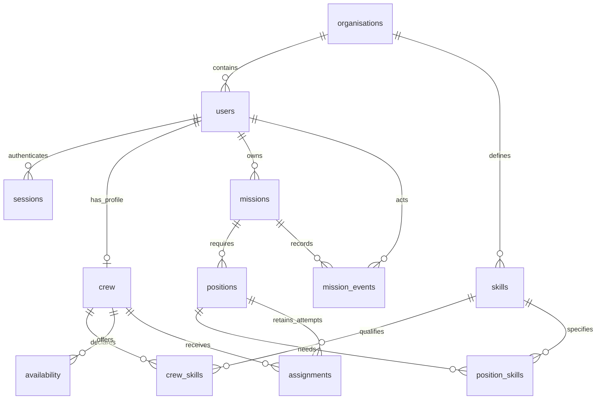

# Database schema

Full target alongside [DESIGN.md](DESIGN.md) (rules) and [IMPLEMENTATION-PLAN.md](IMPLEMENTATION-PLAN.md) (sequence). **Implemented through step 6.** Current definitions: [schema.ts](src/db/schema.ts) and [migrations](drizzle/). Keep this reference aligned with implementation; record departures in [DESIGN-DEVIATIONS.md](DESIGN-DEVIATIONS.md).

## Conventions

- Columns are NOT NULL unless marked `?`; `= value` denotes a database default. PostgreSQL uses snake_case; Drizzle uses camelCase.
- Common columns: `id uuid PRIMARY KEY DEFAULT gen_random_uuid()`, `tenant_id uuid`. Exceptions: organisations has no tenant ID; sessions and skill joins have their stated primary keys instead of `id`.
- `UQ(...)` means unique. All FKs use NO ACTION on update/delete. Composite references enforce tenant/mission ownership; reads still require tenant/visibility scoping, without RLS.
- Timestamps are finite `timestamptz`; intervals are `[start,end)` with `start < end`. Future-start checks belong in locked domain operations.

## Relationships



## Implemented: steps 1–2

Table columns below extend the common columns.

| Table | Columns | Essential constraints |
| --- | --- | --- |
| `organisations` | `slug text`, `name text` | Unique slug: `^[a-z0-9]+(-[a-z0-9]+)*$`, at most 64 characters. Trimmed name length 1–120. |
| `users` | `username text`, `display_name text`, `password_hash text`, `role role` | `UQ(tenant_id,id)`; `UQ(tenant_id,username)`. Username matches `^[a-z0-9][a-z0-9._-]{0,63}$`; trimmed display name length 1–120; nonempty password hash. |
| `sessions` | `token_hash text PRIMARY KEY`, `user_id uuid`, `expires_at timestamptz` | 64 lowercase hex hash; writer sets expiry to login + 24 hours. |
| `crew` | `user_id uuid`, `biography text = ''`, `active boolean = true` | `UQ(tenant_id,id)`; `UQ(tenant_id,user_id)`; biography at most 2000 characters. Display name comes from `users`. |
| `skills` | `name text` | `UQ(tenant_id,id)`; `UQ(tenant_id,name)`; name equals `lower(trim(name))`, length 1–80. |
| `crew_skills` | `crew_id uuid`, `skill_id uuid`, `proficiency integer` | `PRIMARY KEY(tenant_id,crew_id,skill_id)`; proficiency 1–5. |
| `availability` | `crew_id uuid`, `start timestamptz`, `end timestamptz` | Positive interval; overlapping, adjacent and duplicate windows allowed. Coverage uses their union. |

`role`: `director`, `lead`, `crew`. Any role may have a crew profile. `active` affects staffing eligibility only.

## Mission tables: steps 3–4 implemented

| Table / introduction | Columns | Essential constraints |
| --- | --- | --- |
| `missions` / step 3 | `owner_id uuid`, `title text`, `brief text`, `start timestamptz`, `end timestamptz`, `state mission_state = 'draft'`, `version integer = 1`, `created_at timestamptz = clock_timestamp()` | `UQ(tenant_id,id)`; version ≥ 1; trimmed title length 1–120, brief ≤ 4000; positive interval; owner is creator. |
| `positions` / step 3 | `mission_id uuid`, `ordinal integer`, `label text`, `removed_at timestamptz?` | `UQ(tenant_id,mission_id,id)`; `UQ(tenant_id,mission_id,ordinal)`; ordinal ≥ 1; trimmed label length 1–120. |
| `position_skills` / step 3 | `mission_id uuid`, `position_id uuid`, `skill_id uuid`, `min_proficiency integer` | `PRIMARY KEY(tenant_id,mission_id,position_id,skill_id)`; minimum proficiency 1–5; all requirements must be met. |
| `assignments` / step 4 | `mission_id uuid`, `position_id uuid`, `crew_id uuid`, `state assignment_state = 'proposed'`, `responded_at timestamptz?`, `booked_start timestamptz?`, `booked_end timestamptz?` | One row per proposal attempt; booking constraints below. |
| `mission_events` / step 3, extended in steps 4–6 | `mission_id uuid`, `mission_version integer`, `actor_id uuid`, `kind text`, `occurred_at timestamptz = clock_timestamp()`, `payload jsonb` | `UQ(tenant_id,mission_id,mission_version)`; version ≥ 1; `jsonb_typeof(payload) = 'object'`. Append-only. |

- `mission_state`: `draft`, `submitted`, `approved`, `completed`, `cancelled`. Approved phase is derived (`scheduled`, `active`, `awaiting_completion`), never stored; other states have no phase. Rejection returns to draft.
- `assignment_state`: `proposed`, `accepted`, `declined`, `confirmed`, `withdrawn`, `released`.

Under the mission lock, allocate `coalesce(max(ordinal),0) + 1`, including removed positions. Retain accounts, missions, positions and assignment attempts. Draft requirement joins may change; events preserve historical values and approval/proposal details.

## Foreign keys

| Child columns | Referenced columns |
| --- | --- |
| `users(tenant_id)`, `skills(tenant_id)` | `organisations(id)` |
| `sessions(tenant_id,user_id)`, `crew(tenant_id,user_id)` | `users(tenant_id,id)` |
| `crew_skills(tenant_id,crew_id)`, `availability(tenant_id,crew_id)` | `crew(tenant_id,id)` |
| `crew_skills(tenant_id,skill_id)` | `skills(tenant_id,id)` |
| `missions(tenant_id,owner_id)` | `users(tenant_id,id)` |
| `positions(tenant_id,mission_id)` | `missions(tenant_id,id)` |
| `position_skills(tenant_id,mission_id,position_id)`, `assignments(tenant_id,mission_id,position_id)` | `positions(tenant_id,mission_id,id)` |
| `position_skills(tenant_id,skill_id)` | `skills(tenant_id,id)` |
| `assignments(tenant_id,crew_id)` | `crew(tenant_id,id)` |
| `mission_events(tenant_id,mission_id)` | `missions(tenant_id,id)` |
| `mission_events(tenant_id,actor_id)` | `users(tenant_id,id)` |

Assignments/requirements reach missions through positions; no duplicate mission FK is needed. Referenced skills cannot be deleted; event snapshots preserve historical names/requirements.

## Assignment constraints: step 4

Partial unique indexes, both WHERE state IN (`proposed`,`accepted`,`confirmed`):

- `(tenant_id,mission_id,position_id)`
- `(tenant_id,mission_id,crew_id)`

These allow one current person per position and one current position per person per mission. For swaps, withdraw replaced assignments before inserting new rows in the same transaction.

CHECKs:

- `proposed`: response time NULL. `accepted`/`declined`/`confirmed`: response time required. `withdrawn`/`released`: may retain it. Consent resets clear it and preserve the prior response in events.
- `confirmed`: both booking endpoints required, finite and increasing. All other states: both NULL. Approval copies the mission interval atomically.

Migration credentials install `btree_gist` for:

```sql
EXCLUDE USING gist (
  tenant_id WITH =,
  crew_id WITH =,
  tstzrange(booked_start, booked_end, '[)') WITH &&
) WHERE (state = 'confirmed')
```

Adjacent bookings are valid. Completion retains bookings; cancellation releases them and clears endpoints. Calculate workload from confirmed intervals clipped to the proposed start month's UTC boundaries, including completed work. No separate reservations table or stored workload totals.

## Events

One event per actual mutation, at its resulting mission version, in the same transaction. Creation uses version 1; bulk changes share one event; no-ops create none. Order by mission version. Current state stays in relational rows; no event replay.

`kind` has a fixed domain/database CHECK allowlist, introduced by step: `mission_created`, `mission_updated`, `position_added`, `position_updated`, `position_removed`, `proposals_updated`, `assignment_responded`, `mission_submitted`, `mission_withdrawn`, `mission_rejected`, `mission_approved`, `mission_completed`, `mission_cancelled`.

Domain-validated payloads retain changed values/reasons and relevant proposal/consent snapshots: title, brief, times, position label, skill IDs/names/levels, assignment/crew IDs and response changes. `payload.assignmentChanges` records before/after attempt snapshots with the offered plan and position; Crew history filters and allowlists only their own changes before pagination. Material edits preserve before/after values and invalidated acceptances; releases preserve former booking intervals.

Snapshot IDs are historical values, not FKs or access grants. Build payloads from scoped rows under the mission lock. Crew receives only its own assignment/relevant plan projection, never raw event JSON. Runtime grants: SELECT/INSERT only; revoke UPDATE/DELETE.

## Additional indexes

Implemented beyond PK/unique/exclusion indexes: `sessions(tenant_id,user_id)`, `crew_skills(tenant_id,skill_id)`, `availability(tenant_id,crew_id,start)`, `missions(tenant_id,state,id)`, `position_skills(tenant_id,skill_id)`, `assignments(tenant_id,crew_id,mission_id)` and `assignments(tenant_id,mission_id,position_id)` (including terminal attempts).

Existing unique prefixes cover tenant listings, position order and mission history. Substring search scans tenant rows initially.

Permissions, transitions, independent approval, full eligibility and consent invalidation remain domain checks under DESIGN.md's locks. Crew edits recheck future/active approved commitments under the same crew locks as approval, without locking missions. Migration tests cover composite FKs, row checks, current-assignment uniqueness, booking overlap/adjacency and append-only events; workflow/race tests follow the implementation plan.
